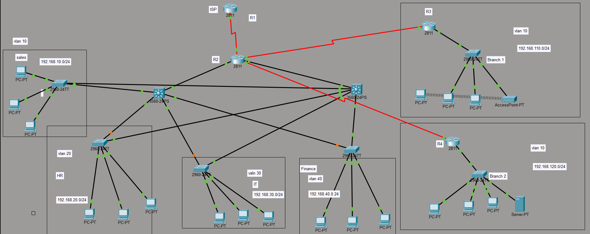

# Enterprise Multi-Branch Network Infrastructure

## Project Overview

This project demonstrates the design and configuration of an enterprise multi-branch network using Cisco networking technologies. The network connects headquarters with multiple branch offices and departments, featuring Layer 2 switching, Layer 3 multilayer switches, VLAN segmentation, and dynamic OSPF routing.

## Network Topology



## Technologies & Protocols Used

* **Cisco IOS**
* **VLANs & 802.1Q Trunking**
* **Inter-VLAN Routing & Layer 3 Switching**
* **OSPF Dynamic Routing**
* **Spanning Tree Protocol (STP & PortFast)**
* **IPv4 Subnetting & Addressing**
* **Router & Switch Security Configurations**
* **Network Verification & Troubleshooting (Ping, Traceroute)**

## Project Structure

```text
Enterprise-Network/
├── Cisco Packet Tracer/
│   ├── Enterprise-Multi-Branch-Network-Infrastructure.pkt
│   └── ---- project Enterprise Multi-Branch Network Infrastructure.pkt
├── Documentation/
│   ├── Project-Overview.md
│   ├── Topology.md
│   ├── IP-Addressing.md
│   ├── VLAN-Configuration.md
│   ├── OSPF-Routing.md
│   ├── Router-Configuration.md
│   ├── Switch-Configuration.md
│   ├── Verification.md
│   └── Final-Notes.md
├── ROUTER CONFIGURATIONS/
│   ├── MLS1-hq-config.txt
│   ├── router-config.txt
│   ├── Switch1-config.txt
│   ├── Switch2-config.txt
│   ├── switch3-it-config.txt
│   ├── Switch4-finance-config.txt
│   ├── switch5-branch1-config.txt
│   └── Switch6-branch2-config.txt
└── Topology/
    └── Topology.png
```

## Device Configurations

All running device configurations can be found in the [`ROUTER CONFIGURATIONS`](ROUTER%20CONFIGURATIONS/) folder:
- **Headquarters MLS:** `MLS1-hq-config.txt`
- **HQ Router:** `router-config.txt`
- **Department Switches:** `Switch1-config.txt`, `Switch2-config.txt`, `switch3-it-config.txt` (IT), `Switch4-finance-config.txt` (Finance)
- **Branch Switches:** `switch5-branch1-config.txt` (Branch 1), `Switch6-branch2-config.txt` (Branch 2)

## Documentation

Comprehensive project design documentation is available in the [`Documentation`](Documentation/) folder:
- [Project Overview](Documentation/Project-Overview.md)
- [Topology Details](Documentation/Topology.md)
- [IP Addressing Plan](Documentation/IP-Addressing.md)
- [VLAN Setup](Documentation/VLAN-Configuration.md)
- [OSPF Dynamic Routing](Documentation/OSPF-Routing.md)
- [Router Configurations](Documentation/Router-Configuration.md)
- [Switch Configurations](Documentation/Switch-Configuration.md)
- [Connectivity Verification](Documentation/Verification.md)
- [Final Notes](Documentation/Final-Notes.md)

## How to Run in Cisco Packet Tracer

1. Download and open `Enterprise-Multi-Branch-Network-Infrastructure.pkt` in Cisco Packet Tracer (v8.0+ recommended).
2. Allow spanning tree convergence (green link indicators).
3. Verify routing tables (`show ip route`) and OSPF neighbor adjacencies (`show ip ospf neighbor`).
4. Test end-to-end ping across departments and branches.
